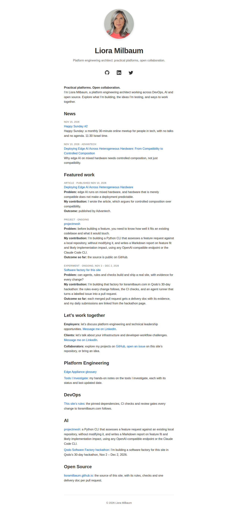

# feat: Add a skip link, visible focus and reduced motion to both layouts

**PR:** [#97](https://github.com/lioramilbaum/lioramilbaum.github.io/pull/97) · **Opened:** 2026-11-14 · **Hackathon:** Day 7 of the Qodo Software Factory hackathon, [Close the feedback loop](https://github.com/orgs/qodo-hackathon/discussions/9): this PR's Qodo findings are resolved with Review Resolver (tracking issue #96). The Day 7 link on the hackathon page follows in a separate docs change, after the Day 7 comment is posted, as Day 6's did.

## Why

_From the PR description (author-written)._

Keyboard users could not see where focus was on the homepage's social icons, and could not skip past them or the docs pages' back link. Neither layout had a skip link or a reduced-motion rule, and `_layouts/home.html` had no focus style at all. Other hackathon builders kept raising these issues (#72 links the threads), along with layouts that break at 320 px or at high zoom. `scripts/check-browser.sh` checked only JavaScript off and colour contrast, and only on the hackathon page.

## How

_From the PR description (author-written)._

- **A skip link that skips something.** Before this change, `<main>` wrapped the whole page, so a link to it would have skipped nothing. Both layouts now put a `.page` wrapper around everything, and the old `main` styles move to it. `<main id="main" tabindex="-1">` now wraps only the content: the avatar, name, tagline and social links (homepage) and the back link (docs pages) sit before it, and the footer sits after it. `tabindex="-1"` lets the browser move focus to `<main>` when the link is followed. Nothing at rest moves: a homepage screenshot of this branch is byte-identical to one of main.
- **One shared CSS block, byte-identical in both layouts** (rule 4), between two marker comments:
  - The skip link is hidden off-canvas until focused, then shown at the top left: `#0366d6` on `#fff`, or `#58a6ff` on `#1a1a1a` in dark mode.
  - `:focus-visible` draws a 2px solid outline, `#0366d6` (about 5.4:1 on white) or `#58a6ff` in dark mode (about 6.9:1 on `#1a1a1a`). The dark palette is unchanged.
  - `main:focus { outline: none }`, since `<main>` is a skip target, not a control.
  - `prefers-reduced-motion: reduce` turns off transitions, animations and smooth scrolling. The homepage's social-link colour transition is the one it affects today.
- **`scripts/check-browser.sh`** now walks the built site and checks every page. It fails if the homepage, the glossary, the hackathon page or the tools index is missing. New cases:
  - **Skip link** (light and dark): the first Tab focuses "Skip to content", which links to `#main`, is inside the viewport and has at least 4.5:1 text contrast. Enter moves focus to `main#main`, which draws no outline, and the next Tab lands inside `<main>`. Only the glossary and the tools index may skip that last step, because their `<main>` has no link; the skip prints a line saying so.
  - **Focus outline** (light and dark): Tab through every focusable element. Each one must be reached and must match `:focus-visible`, with a solid opaque outline of at least 2px and at least 3:1 contrast against the background behind it. Finding no focusable element, or an outline the browser draws itself (`auto`), is a failure (rule 11). Elements Tab cannot reach (disabled, hidden, inert, out of the tab order, inside a closed `<details>`, or a second `<summary>`) are left out, and a `skipped:` line names them.
  - **Reflow**: no horizontal scroll at a 320 px viewport, or at a 640 px CSS viewport (1280 px at 200% zoom). An unreadable width is a failure. Any `<script>` on any page also fails.
  - **Reduced motion**: the homepage's social link transitions in 0.2s by default and in 0s under `reduce`, which proves the check reads the value. Under `reduce`, no element on any page transitions or animates.
  - **Screenshot invariance**: at rest, the skip link sits off-canvas, and a full-page homepage screenshot is identical with the link hidden (rule 7).
- **`scripts/check-site.sh`** checks, on every built page (and it fails if the homepage, the glossary, the hackathon page or the tools index is missing), that the skip link comes right after `<body>` and that the page's one `<main>` element is `<main id="main" tabindex="-1">`. It also checks that the shared block is non-empty, holds the three rules, and is identical on every page.
- **A flaky-check fix in `scripts/check-site.sh`.** Its twelve `producer | grep -q` assertions now read from a here-string (`grep -q PAT <<<"$(producer)"`), so the producer always finishes before `grep` reads. Patterns and messages are unchanged. In an `ubuntu:24.04` container, the old script failed 49 of 50 runs on this build and the new one failed none. An assertion whose pattern can't match still fails with its message.

**Red CI runs (rule 8).** This branch was pushed in stages, each amending its one commit:
1. Only the new `check-browser.sh` cases, on the old layouts: the Browser check is red. ([run](https://github.com/lioramilbaum/lioramilbaum.github.io/actions/runs/43622903688), commit d42ff59) — red: skip link, focus outline, reduced motion, screenshot cases
2. Plus the `check-site.sh` assertions: Check site is red. ([run](https://github.com/lioramilbaum/lioramilbaum.github.io/actions/runs/43623038718), commit 3b52545) — red: skip link is not the first element in body (Check site)
3. Plus the layouts, with a deliberate break in `_layouts/home.html` (forced overflow and an empty `<script>`): the reflow and no-script cases are red. ([run](https://github.com/lioramilbaum/lioramilbaum.github.io/actions/runs/43623112521), commit af31faa) — red: horizontal scroll at 320 px and 200% zoom, script element (Browser check)
4. The change with the break removed, expected green: Check site is red with "## News must come before ## Platform Engineering". ([run](https://github.com/lioramilbaum/lioramilbaum.github.io/actions/runs/43623234272), commit 826f670). The cause is a race already on main, not this change: `check-site.sh` runs under `set -o pipefail`, and `sed … | grep -q` fails when `grep` exits at its first match before `sed` has written all its output, because `sed` then dies of SIGPIPE. This PR's CSS moved the News heading to byte 8055 of the homepage, inside `sed`'s second 4 KB buffer, so the check failed in 275 of 300 runs on Linux (and 0 on macOS). In R3, the deliberate break's extra CSS had pushed News into the last buffer, which is why it passed.
5. The final change, with the race fixed: green. ([run](https://github.com/lioramilbaum/lioramilbaum.github.io/actions/runs/43623744507), commit cc4b58d). 9103dfc has the same tree, with the commit trailer corrected, and is green too ([run](https://github.com/lioramilbaum/lioramilbaum.github.io/actions/runs/43624070731)).

In stage 1, the reflow and `<script>` cases ran on the old layouts and passed, because main has no overflow and no `<script>` for them to catch. Stage 3's deliberate break is their run against a failing input (rule 8). Later amendments add the fixes for Qodo's findings (see Qodo notes), each green in CI.

## What

_From the PR description (author-written)._

- `_layouts/home.html`, `_layouts/docs.html`: the `.page` wrapper, the narrowed `<main>`, the skip link and the shared CSS block.
- `scripts/check-browser.sh`: the page walk and the five new cases.
- `scripts/check-site.sh`: the skip-link, `<main>` and shared-block assertions, and the pipe-race fix for its existing assertions.
- `AGENTS.md`: the Verify comment for `scripts/check-browser.sh` says what it now covers. No rule text changes.

Nothing under `.github/` or `_config.yml` changes. CI's Browser check step already runs when `_layouts/` or `scripts/check-browser.sh` changes.

## Evidence

- Ran in CI: [run 43632651687](https://github.com/lioramilbaum/lioramilbaum.github.io/actions/runs/43632651687) on c1366f1 (content b204264ac26c7d5334d4f9940dc498723d8de6ad). Jobs: build: success.
- Homepage: changed. The head build (H 76e65e3501fd00694a0bb758301ebb475a9fa66d) differs from the merge-base b8b6d1c build. Screenshot below.
- Local: built the head and the merge-base (b8b6d1c) with scripts/build-site.sh, and compared their homepages.

## Screenshot or demo



## What I learned from the Qodo review

Qodo reviewed these contents (by content digest): `166323115e1feb73e5f38ddd3085d64207dbf836`, `6ee6204cb83d587ddc4dd7878d1447e01d8cd053`, `c3bd044f321a0e0caa38aebbec75afd6fea49733`, `8351928c4dc6d38e63db9b77c617128209fada3e`, `abb8c13fa3a096dcdeeb0303c1c0a240f5850e36`, `9ab6eb738eb9aa24103d86107651fa7adef1f080`, `b204264ac26c7d5334d4f9940dc498723d8de6ad`. Its latest review is content `b204264ac26c7d5334d4f9940dc498723d8de6ad`.

- Hidden or disabled controls will fail the focus check (Low, 🐞 Bug). No longer listed by Qodo. Reviewed in content `166323115e1feb73e5f38ddd3085d64207dbf836`.
- Site check comment claims more pages than it checks (Low, 🐞 Bug). No longer listed by Qodo. Reviewed in content `166323115e1feb73e5f38ddd3085d64207dbf836`.
- Reflow checks unproven on old layouts (Medium, 📎 Requirement gap). No longer listed by Qodo. Reviewed in content `6ee6204cb83d587ddc4dd7878d1447e01d8cd053`.
- Dotted focus rings pass browser checks (Medium, 🐞 Bug). No longer listed by Qodo. Reviewed in content `6ee6204cb83d587ddc4dd7878d1447e01d8cd053`.
- Body animation escapes motion checks (Low, 🐞 Bug). No longer listed by Qodo. Reviewed in content `6ee6204cb83d587ddc4dd7878d1447e01d8cd053`.
- Links taken out of tab order fail the focus check (Low, 🐞 Bug). No longer listed by Qodo. Reviewed in content `c3bd044f321a0e0caa38aebbec75afd6fea49733`, `8351928c4dc6d38e63db9b77c617128209fada3e`.
- Day 7 hackathon submission link is not added (Medium, 📎 Requirement gap). No longer listed by Qodo. Reviewed in content `8351928c4dc6d38e63db9b77c617128209fada3e`.
- Block-mismatch error blames the wrong layout (Low, 🐞 Bug). No longer listed by Qodo. Reviewed in content `8351928c4dc6d38e63db9b77c617128209fada3e`, `abb8c13fa3a096dcdeeb0303c1c0a240f5850e36`.
- Duplicate main landmarks pass site checks (Medium, 🐞 Bug). No longer listed by Qodo. Reviewed in content `abb8c13fa3a096dcdeeb0303c1c0a240f5850e36`.
- Unreadable site listing passes silently (Medium, 📘 Rule violation). No longer listed by Qodo. Reviewed in content `9ab6eb738eb9aa24103d86107651fa7adef1f080`.
- An unlisted Tab stop ends the focus walk and blames later links (Low, 🐞 Bug). No longer listed by Qodo. Reviewed in content `9ab6eb738eb9aa24103d86107651fa7adef1f080`.
- Final Qodo review of head is unrecorded (Medium, 📎 Requirement gap). No longer listed by Qodo. Reviewed in content `b204264ac26c7d5334d4f9940dc498723d8de6ad`.

Open findings in Qodo's latest review: 0.

_From the PR description (author-written)._

Qodo's review of 9103dfc raised two informational findings. Both were investigated with Qodo's Review Resolver skill and fixed in this PR; none was dismissed.

- **Hidden or disabled controls will fail the focus check** (Reliability, `scripts/check-browser.sh`). It was valid: the focus check counted disabled, hidden and inert elements, which Tab skips, so a collapsed menu (#42) would have failed CI on correct keyboard behaviour. Fixed: only elements Tab can reach are checked, and the others are named in a `skipped:` line. A run with a disabled button, a hidden link, an inert link and a `<details>` passes with the new check and fails with the old one ("not reached by Tab").
- **Site check comment claims more pages than it checks** (Maintainability, `scripts/check-site.sh`). It was valid: the comment said every page, but the code checked four. Fixed in the code, not the comment: `check-site.sh` now walks every built page, as `check-browser.sh` does, and still requires the four known pages. A built page without the skip link now fails ("skip link is not the first element in <body> of docs/extra/index.html").

Qodo's re-review of b38c355 marked both fixes implemented and raised three more findings:

- **Dotted focus rings pass browser checks** (Correctness, `scripts/check-browser.sh`). It was valid: the outline check rejected only `none`, `hidden` and `auto`. Fixed: the outline must be `solid`.
- **Body animation escapes motion checks** (Correctness, `scripts/check-browser.sh`). It was valid: the reduced-motion scan covered `<html>` and the elements inside `<body>`, but not `<body>` itself. Fixed: `<body>` is scanned too.
- **Reflow checks unproven on old layouts** (Correctness). **Dismissed as a false positive**, with the owner's approval. Rule 8 asks for a CI run against a failing input, and stage 3's run is that run: the reflow and `<script>` cases failed there. On the old layouts they passed, because main has nothing for them to catch. Qodo's own evidence says the failure criterion is met for those cases.

Qodo's review of a0d3bdb marked both of those fixes implemented, kept the dismissal, and raised one more finding:

- **Links taken out of tab order fail the focus check** (Reliability, `scripts/check-browser.sh`). It was valid: the round-1 filter missed a link or control with a negative `tabindex`, which Tab skips. Fixed: those elements are listed in the `skipped:` line too. Qodo's next review still listed it against a0d3bdb, so it was marked implemented once the fix was on the head (rule 9).

Qodo's review of acc2b4f was the third re-review in a row to add findings, so the loop stopped there and the owner decided the two open findings:

- **Block-mismatch error blames the wrong layout** (Maintainability, `scripts/check-site.sh`). It was valid, and came from the round-1 page walk: the glossary sorts first, so a drift in `docs.html` was reported against `_layouts/home.html`. Fixed: every page is compared against the homepage's block. A mismatch is reported on the page that differs, annotated with that page's layout, and the message names both layout files.
- **Day 7 hackathon submission link is not added**. **Dismissed as a false positive**, with the owner's approval. This PR closes #72. The Day 7 link is #96's criterion, and it can only be added after the Day 7 comment exists, which is written after this review loop.

Qodo's review of f67b329 still listed the block-mismatch finding against acc2b4f, so it was marked implemented once the fix was on the head. That review raised one more finding:

- **Duplicate main landmarks pass site checks** (`scripts/check-site.sh`). It was valid: the count matched only the exact `<main id="main" tabindex="-1">` tag, so a second `<main>` in a page's content passed. Fixed: a page must have exactly one `<main>` element, and it must be that tag.

Qodo's review of 32dc995 marked that fix implemented and raised two more findings, both fixed:

- **Unreadable site listing passes silently** (`scripts/check-site.sh`). It was valid, and broke rule 11: the page walk discarded `find`'s exit status, so a directory it couldn't read left a partial page list that still passed. Fixed: a failed listing fails the check.
- **An unlisted Tab stop ends the focus walk and blames later links** (`scripts/check-browser.sh`). It was valid: if Tab landed on an element the check doesn't list (a focusable scroll container, an `iframe`, `contenteditable`), the walk stopped and reported every later link as unreached. Fixed: the check names the unlisted element and keeps walking. The walk's cap also grows with the unlisted stops it finds, so a page with several of them can't end the walk before every listed element is reached.

**Final review.** Qodo's review of c1366f1, the head ([CI run](https://github.com/lioramilbaum/lioramilbaum.github.io/actions/runs/43632651687), green), marked both of those fixes implemented. All 11 code findings across seven reviews are closed: 9 fixed (7 re-attributed by Qodo itself, 2 marked implemented once their fix was on the head) and 2 dismissed as false positives with the owner's approval. Its one remaining finding asked for this record of the final review, and was marked implemented once the record was added.

## Assistance and third-party material

_From the PR description (author-written)._

Written by Claude Code (claude-opus-5-5) in Liora's local session, through the feature-workflow skill: a planner, an executor, two reviewer passes and git-ops. No third-party material was added.

## Limitations

_From the PR description (author-written)._

- **200% zoom is emulated.** The check sets a 640 px CSS viewport, which is how a 1280 px window lays out at 200% zoom. It does not drive the browser's own zoom control.
- **Screen readers are not tested.** The checks cover keyboard focus and layout, not how assistive technology announces the skip link.
- **Reduced motion is proved only on the homepage.** `docs.html` has no transitions, so on the docs pages the reduced-motion case cannot fail. `check-site.sh`'s identical-block assertion is what carries the rule there.
- **The homepage still gets a screenshot.** Its HTML changed, so after the merge the delivery-doc generator will commit a PNG (rule 7). The CI invariance case, and a local byte-for-byte comparison with main's screenshot, show that the PNG looks the same as main's.

## Discussion post

For the owner to post in the day's thread. The skill never posts to the hackathon discussions.

````markdown
## Challenge

Day 7 of the Qodo Software Factory hackathon, [Close the feedback loop](https://github.com/orgs/qodo-hackathon/discussions/9): this PR's Qodo findings are resolved with Review Resolver (tracking issue #96). The Day 7 link on the hackathon page follows in a separate docs change, after the Day 7 comment is posted, as Day 6's did.

## Project

Project name: lioramilbaum.com
Repository link: https://github.com/lioramilbaum/lioramilbaum.github.io
Relevant pull request or commit: https://github.com/lioramilbaum/lioramilbaum.github.io/pull/97 ([delivery notes](https://github.com/lioramilbaum/lioramilbaum.github.io/blob/main/deliveries/2026-11-14-issue-72.md))

## What I completed

Keyboard users could not see where focus was on the homepage's social icons, and could not skip past them or the docs pages' back link. Neither layout had a skip link or a reduced-motion rule, and `_layouts/home.html` had no focus style at all. Other hackathon builders kept raising these issues (#72 links the threads), along with layouts that break at 320 px or at high zoom. `scripts/check-browser.sh` checked only JavaScript off and colour contrast, and only on the hackathon page.

- `_layouts/home.html`, `_layouts/docs.html`: the `.page` wrapper, the narrowed `<main>`, the skip link and the shared CSS block.
- `scripts/check-browser.sh`: the page walk and the five new cases.
- `scripts/check-site.sh`: the skip-link, `<main>` and shared-block assertions, and the pipe-race fix for its existing assertions.
- `AGENTS.md`: the Verify comment for `scripts/check-browser.sh` says what it now covers. No rule text changes.

Nothing under `.github/` or `_config.yml` changes. CI's Browser check step already runs when `_layouts/` or `scripts/check-browser.sh` changes.

## Evidence

- Ran in CI: [run 43632651687](https://github.com/lioramilbaum/lioramilbaum.github.io/actions/runs/43632651687) on c1366f1 (content b204264ac26c7d5334d4f9940dc498723d8de6ad). Jobs: build: success.
- Homepage: changed. The head build (H 76e65e3501fd00694a0bb758301ebb475a9fa66d) differs from the merge-base b8b6d1c build. Screenshot below.
- Local: built the head and the merge-base (b8b6d1c) with scripts/build-site.sh, and compared their homepages.

## What I learned / what is blocked

Qodo reviewed these contents (by content digest): `166323115e1feb73e5f38ddd3085d64207dbf836`, `6ee6204cb83d587ddc4dd7878d1447e01d8cd053`, `c3bd044f321a0e0caa38aebbec75afd6fea49733`, `8351928c4dc6d38e63db9b77c617128209fada3e`, `abb8c13fa3a096dcdeeb0303c1c0a240f5850e36`, `9ab6eb738eb9aa24103d86107651fa7adef1f080`, `b204264ac26c7d5334d4f9940dc498723d8de6ad`. Its latest review is content `b204264ac26c7d5334d4f9940dc498723d8de6ad`.

- Hidden or disabled controls will fail the focus check (Low, 🐞 Bug). No longer listed by Qodo. Reviewed in content `166323115e1feb73e5f38ddd3085d64207dbf836`.
- Site check comment claims more pages than it checks (Low, 🐞 Bug). No longer listed by Qodo. Reviewed in content `166323115e1feb73e5f38ddd3085d64207dbf836`.
- Reflow checks unproven on old layouts (Medium, 📎 Requirement gap). No longer listed by Qodo. Reviewed in content `6ee6204cb83d587ddc4dd7878d1447e01d8cd053`.
- Dotted focus rings pass browser checks (Medium, 🐞 Bug). No longer listed by Qodo. Reviewed in content `6ee6204cb83d587ddc4dd7878d1447e01d8cd053`.
- Body animation escapes motion checks (Low, 🐞 Bug). No longer listed by Qodo. Reviewed in content `6ee6204cb83d587ddc4dd7878d1447e01d8cd053`.
- Links taken out of tab order fail the focus check (Low, 🐞 Bug). No longer listed by Qodo. Reviewed in content `c3bd044f321a0e0caa38aebbec75afd6fea49733`, `8351928c4dc6d38e63db9b77c617128209fada3e`.
- Day 7 hackathon submission link is not added (Medium, 📎 Requirement gap). No longer listed by Qodo. Reviewed in content `8351928c4dc6d38e63db9b77c617128209fada3e`.
- Block-mismatch error blames the wrong layout (Low, 🐞 Bug). No longer listed by Qodo. Reviewed in content `8351928c4dc6d38e63db9b77c617128209fada3e`, `abb8c13fa3a096dcdeeb0303c1c0a240f5850e36`.
- Duplicate main landmarks pass site checks (Medium, 🐞 Bug). No longer listed by Qodo. Reviewed in content `abb8c13fa3a096dcdeeb0303c1c0a240f5850e36`.
- Unreadable site listing passes silently (Medium, 📘 Rule violation). No longer listed by Qodo. Reviewed in content `9ab6eb738eb9aa24103d86107651fa7adef1f080`.
- An unlisted Tab stop ends the focus walk and blames later links (Low, 🐞 Bug). No longer listed by Qodo. Reviewed in content `9ab6eb738eb9aa24103d86107651fa7adef1f080`.
- Final Qodo review of head is unrecorded (Medium, 📎 Requirement gap). No longer listed by Qodo. Reviewed in content `b204264ac26c7d5334d4f9940dc498723d8de6ad`.

Open findings in Qodo's latest review: 0.

- **200% zoom is emulated.** The check sets a 640 px CSS viewport, which is how a 1280 px window lays out at 200% zoom. It does not drive the browser's own zoom control.
- **Screen readers are not tested.** The checks cover keyboard focus and layout, not how assistive technology announces the skip link.
- **Reduced motion is proved only on the homepage.** `docs.html` has no transitions, so on the docs pages the reduced-motion case cannot fail. `check-site.sh`'s identical-block assertion is what carries the rule there.
- **The homepage still gets a screenshot.** Its HTML changed, so after the merge the delivery-doc generator will commit a PNG (rule 7). The CI invariance case, and a local byte-for-byte comparison with main's screenshot, show that the PNG looks the same as main's.

## Assistance and third-party material

Written by Claude Code (claude-opus-5-5) in Liora's local session, through the feature-workflow skill: a planner, an executor, two reviewer passes and git-ops. No third-party material was added.

## Optional demo


````
<!-- delivery: content=b204264ac26c7d5334d4f9940dc498723d8de6ad head=c1366f19b73c2e47cddabd1938359b48b68cca8f homepage=76e65e3501fd00694a0bb758301ebb475a9fa66d qodo-open=0 -->
